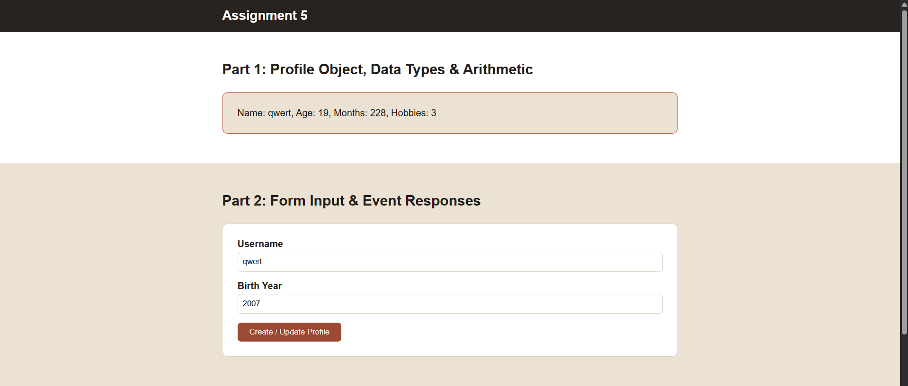

# Assignment 5. JavaScript Basics (DOM Manipulation & Events)

**Name:** Madina Sabyrgali
**Group:** IT-2503

---

## Part 1: Profile Object, Data Types & Arithmetic

### Task 1. The Personal Info Object
Create a JavaScript const object named `userProfile` that stores a string (name), a number (birthYear), a boolean (isDeveloper) and an array (hobbies).

### Task 2. Arithmetic Calculations
Calculate the user's current age dynamically (current year minus birthYear), and another metric (months old and hobbies count). Display the values in the console and on the page.

---

## Part 2. Form Input & Event Responses

### Task 3. HTML Form Setup
Create a form with an input for Username, an input for Birth Year and a "Create / Update Profile" submit button.

### Task 4. Event Listener
Add a submit event listener to the form. When submitted, capture the input values and update the `userProfile` object.

---

## Part 3: DOM List Manipulation

### Task 5. Creating & Removing Elements
Create an unordered list (`<ul>`), an "Add Item" button that adds a new `<li>` from the user's input, and a "Remove Item" button that deletes the last item.

---

## Summary of work process

I created the `userProfile` object and calculated age, months and hobbies count with arithmetic operators. Then I made a form and added a submit event listener that updates the object and the page text. Finally, I made a list where `createElement` and `appendChild` add items and `removeChild` removes the last one.
